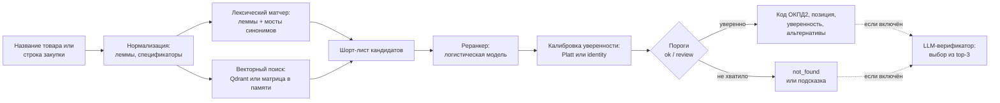
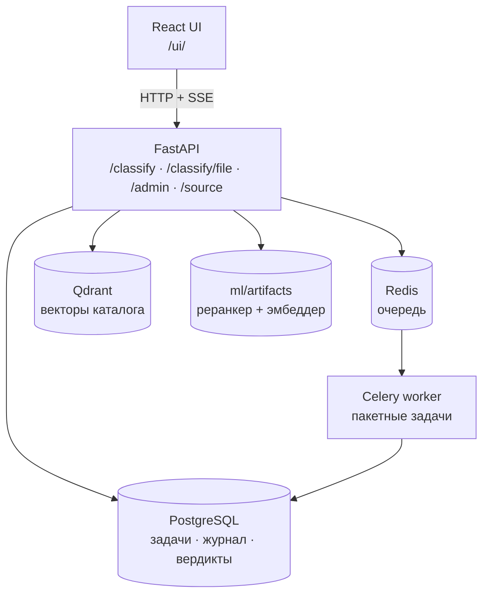

# Dora B2BCase — классификатор товаров по ПП № 1875

# Наше видео с демонстрацией: https://drive.google.com/file/d/1z_slQKm0TohS2sIivm6f28k4ydYAJZ4a/view?usp=drive_link

Веб-сервис для закупок: по названию товара находит **позицию перечня ПП № 1875**
(национальный режим) и **код ОКПД2**, показывает уверенность, альтернативы и даёт
ссылку на страницу постановления. Принимает одиночные запросы, списки до 100 позиций
и файлы из 1С, Excel, Word и PDF.

> Результат — **подсказка для специалиста**, а не юридическое заключение.
> Перечень закрытый, и «нет надёжного совпадения» — корректный ответ для товара вне его состава.

[](https://github.com/tardefine228/Dora-B2BCase/actions/workflows/lint.yml)


**Разделы:** [Проблема](#проблема-и-решение) · [Возможности](#что-умеет) ·
[Быстрый старт](#быстрый-старт-docker) · [Без Docker](#запуск-без-docker) ·
[Как это работает](#как-это-работает) · [Статусы](#три-статуса-ответа) ·
[Качество](#качество-и-проверки) · [API](#api) · [Конфигурация](#конфигурация) ·
[Эксплуатация](#эксплуатация) · [Разработка](#разработка) ·
[Документация](#документация) · [Ограничения](#ограничения-и-дисклеймер)

```bash
git clone https://github.com/tardefine228/Dora-B2BCase.git
cd Dora-B2BCase && docker compose up --build       # первая сборка ~10–15 минут
# UI → http://localhost:8000/ui/   ·   Swagger → http://localhost:8000/docs
```

| Что | Версия / состояние |
| --- | --- |
| Контракт API | **1.0** — только обратносовместимые дополнения ([`docs/api-contract.md`](docs/api-contract.md)) |
| Версия сервиса | 0.4.0 (`/health/ready` → `version`) |
| Последняя приёмка на целевой машине | 26.10.2026 — [`docs/submission-check-2026-10-26.md`](docs/submission-check-2026-10-26.md) |
| Последняя проверка файлов клиента | 29.10.2026 — [`docs/client-files-check-2026-10-29.md`](docs/client-files-check-2026-10-29.md) |
| CI | lint + pytest, контроль артефактов модели, сборка UI, e2e, восстановление PostgreSQL, docker smoke |

---

## Проблема и решение

Специалисту по закупкам нужно понять, попадает ли товар под национальный режим: то есть
найти его в перечне ПП № 1875 и назвать код ОКПД2. Перечень большой, названия в нём
официальные («Устройства ввода или вывода, содержащие или не содержащие в одном корпусе
запоминающие устройства»), а в выгрузках из 1С — торговые («Мышь компьютерная,
беспроводная, 3 шт.»). Сверка вручную — это поиск по постановлению на 145 страниц для
каждой строки.

Сервис закрывает именно этот шаг: **нормализует строку → ищет кандидатов лексикой и по
смыслу → ранжирует обученной моделью → отдаёт код, позицию и уверенность**. Всё остальное
(условия закупки, ограничения, юридические последствия) остаётся за специалистом.

### Каталог в цифрах

| Показатель | Значение |
| --- | ---: |
| Строк в перечне (`data/data.csv`) | 1 126 |
| Уникальных пар «название + код ОКПД2» (индексируется) | 984 |
| Уникальных наименований позиций | 746 |
| Уникальных кодов ОКПД2 | 733 |
| Приложений | 4 (162 / 680 / 278 / 6 строк) |
| Семейств позиций, повторяющихся в приложениях 2 и 3 | 81 |
| Страниц исходного текста постановления | 32–98 (`data/source_text.txt`) |

## Что умеет

| Возможность | Что делает |
| --- | --- |
| **Один товар** | `POST /classify` → код ОКПД2, позиция перечня, уверенность 0…1, до трёх альтернатив, ссылка на страницу постановления |
| **Пакет до 100 строк** | `POST /classify/batch` → фоновая задача: API не блокируется, прогресс по SSE или опросом, результат в JSON и CSV |
| **Файл клиента** | `POST /classify/file`: XLSX/XLSM, CSV (в т. ч. cp1251 и `;`), TSV, TXT, MD, JSON, DOCX, PDF; сервер сам находит колонку с товаром |
| **Строка закупки** | Хвост после `;` не ломает поиск: строка скорится целиком **и** только по имени, побеждает более уверенный ответ |
| **Три статуса** | `ok` / `review` / `not_found` вместо «всё или ничего»; UI различает «похожих нет» и «похожие есть, но уверенности мало» |
| **Ссылка на первоисточник** | `clause_url` → `GET /source/{record_id}`: фрагмент текста постановления со страницами позиции, в JSON и в читаемом HTML |
| **Обратная связь** | Кнопки «код верный / неверный / нет в перечне» → `POST /feedback`; вердикты выгружаются и идут в обучение |
| **Каталог без передеплоя** | `POST /admin/catalog` атомарно ставит новый перечень, API и worker подхватывают его на следующем запросе; есть снимки и откат одной командой |
| **Наблюдаемость** | `/metrics` в формате Prometheus, 7 готовых алертов, дашборд Grafana, JSON-логи с `request_id` |
| **Защита и гигиена** | Rate limit по клиенту, доверие `X-Forwarded-For` только явным прокси, лимит тела запроса, админ-ключ, сроки хранения журналов |

### Что важно знать про качество ответа

- **Уверенность** — вероятность того, что код верный, откалиброванная под реальный трафик.
  Статус определяется **сырой** уверенностью (`confidence_raw`), показываемая — калиброванной.
- **`review` — не ошибка.** На реальных выгрузках в этой полосе большинство кодов верные,
  поэтому UI подписывает её «Предварительный результат — проверьте позицию».
- **Тишина — тоже ответ.** Если товара нет в перечне, `not_found` корректнее выдуманного кода;
  при этом альтернативы показываются, когда похожие позиции есть.
- **Дубли между приложениями** не маскируются: если та же позиция есть под другим кодом,
  интерфейс говорит об этом прямо.

## Быстрый старт (Docker)

Нужны Docker Engine или Docker Desktop с Compose v2, ≥8 ГБ свободной RAM и место под образы
и веса модели (лимиты контейнеров по умолчанию: `api` 2 ГБ, `worker` 2 ГБ, `qdrant` 768 МБ,
`postgres` 256 МБ, `redis` 128 МБ).

```bash
git clone https://github.com/tardefine228/Dora-B2BCase.git
cd Dora-B2BCase
docker compose up --build
```

Поднимаются пять сервисов: `api`, `worker` (Celery), `postgres`, `redis`, `qdrant`.

| Адрес | Что там |
| --- | --- |
| <http://localhost:8000/ui/> | интерфейс: один товар, загрузка файла, результаты, экспорт |
| <http://localhost:8000/docs> | Swagger UI, схемы запросов и ответов |
| <http://localhost:8000/health/ready> | готовность и фактическая конфигурация ML-слоя |
| <http://localhost:8000/metrics> | метрики Prometheus |
| <http://127.0.0.1:6333> | Qdrant (только loopback) |

**Первая сборка** долгая (~10–15 минут): PyTorch (CPU), веса эмбеддера с Hugging Face и
обучение реранкера под этот эмбеддер. Слой с загрузками стоит **до** копирования кода и
опирается только на файлы требований, поэтому правки кода/UI не вызывают повторных скачиваний.
Обычный `docker compose up` (без `--build`) ничего не скачивает и стартует за секунды;
векторный кэш и коллекция Qdrant живут в volumes и переживают рестарт.

<details>
<summary>Быстрая сборка без трансформера (~2 минуты)</summary>

```bash
INSTALL_TRANSFORMER=false docker compose up --build
```

Векторный слой останется на офлайн-векторах spaCy. Это рабочий режим (лексика + векторы),
но он **не подтверждает качество E5** — фактический эмбеддер всегда виден в
`/health/ready` → `vector_search.embedder`.
</details>

**Что смотреть после старта.** `GET /health/ready` возвращает не только `status`, но и
фактическую конфигурацию — по ней видно, что реально работает, а не что задумано:

| Поле | Значение |
| --- | --- |
| `classifier_backend` | `catalog` (по умолчанию), `qdrant`, `mock` |
| `vector_search.embedder` | `st-embedder` (E5, 384), `spacy-…` (300), `tfidf` (512) |
| `vector_search.store` | `qdrant` или `memory` (если Qdrant недоступен) |
| `vector_search.reranker` | какой артефакт скорит: `reranker.<тег>.json` или `reranker.json` |
| `vector_search.scoring` | `vector-features` или `lexical-reranker` |
| `job_store` / `queue_backend` | `postgres`/`sqlite` и `celery`/`inprocess` |
| `llm_verifier` | `off` или `on:<модель>` |

При `ALLOW_DEGRADE=false` (по умолчанию) отсутствие калиброванного артефакта реранкера
даёт **503**, а не тихую подмену эвристикой. Полная проверка стека на целевой машине:

```bash
bash scripts/docker_smoke.sh --build
```

Остановка: `docker compose down` (данные остаются в volumes) · `docker compose down -v`
удаляет каталог, БД и векторы.

> **Windows 10/11 + Docker Desktop:** пошаговая инструкция с типовыми ошибками —
> [`docs/START_WINDOWS_DOCKER.md`](docs/START_WINDOWS_DOCKER.md).

## Запуск без Docker

Локально по умолчанию: задачи в SQLite, пакеты выполняются в процессе API, векторы в памяти.

```bash
python -m venv .venv && source .venv/bin/activate      # Windows: .venv\Scripts\activate
python -m pip install -r api/requirements-dev.txt
PYTHONPATH=api uvicorn app.main:app --reload --port 8000 --no-proxy-headers
```

Нужен Python 3.12 (как в образе и CI). API поднимется сразу; `/ui/` отдаст либо собранный
`frontend/dist`, либо исходники фронтенда, если сборки нет.

```bash
# фронтенд в режиме разработки (второй терминал) — Vite проксирует /classify, /source, /feedback
cd frontend && npm ci && npm run dev
# продакшен-сборка, которую отдаёт FastAPI: npm run build
```

Полный стек без Docker включается переменными окружения (`JOB_STORE=postgres`,
`QUEUE_BACKEND=celery`, `VECTOR_STORE=qdrant` и т. д.) — см. [конфигурацию](#конфигурация).
`CLASSIFIER_BACKEND=mock` даёт детерминированную заглушку для разработки интерфейса.

## Как это работает



1. **Нормализация.** Приведение к нижнему регистру, лемматизация (`pymorphy3`), отделение
   спецификаторов («220 В», «IP54», «16 ГБ»), словари мостов «торговое слово → позиция
   перечня» («дрель», «флешка», «реле»).
2. **Два прохода по строке закупки.** Строка из ERP приходит как
   `Машина стиральная LG F2J3NS0W; бытовая; загрузка 6 кг`. Она скорится целиком и только по
   головному имени; побеждает более уверенный ответ, а в `query` возвращается исходный текст.
   Обрезка хвоста не применяется: у 125 названий перечня `;` внутри, и без него позиция
   «уезжает» в соседнюю.
3. **Шорт-лист.** Объединение лексических кандидатов и ближайших по смыслу позиций
   (эмбеддинги каталога в Qdrant; при недоступности — матрица в памяти).
4. **Реранкер.** Логистическая модель с признаками покрытия, мостов и косинуса
   «запрос ↔ кандидат». Артефакт обучается **под конкретный эмбеддер**, потому что шкалы
   косинусов у эмбеддеров разные.
5. **Калибровка и пороги.** Пороги `ok`/`review` берутся из артефакта; карта калибровки
   надевается, только если её сдвиг больше собственной ошибки — иначе публикуется identity.
6. **Третья ступень (опционально).** LLM получает три предложенные позиции и может выбрать
   одну или ответить «нет». Она не запускается на `ok`, не может придумать код, никогда не
   возвращает `ok` и при любой ошибке молча отключается.
7. **Источник.** `pp_link` в каталоге — цитата («ПП № 1875, приложение 2, позиция 339,
   стр. 64»), поэтому страницу отдаёт сам сервис по `clause_url`.



### Из чего собрано

| Слой | Технологии |
| --- | --- |
| API | Python 3.12, FastAPI, Pydantic v2, Uvicorn |
| Интерфейс | React 19, TypeScript, Vite, ExcelJS (экспорт) |
| Хранение | PostgreSQL 16 + Alembic; SQLite для локального запуска |
| Очередь | Redis 7 + Celery |
| ML | логистический реранкер на numpy, TF-IDF, sentence-transformers (E5), spaCy, pymorphy3 |
| Векторы | Qdrant 1.14 или матрица в памяти |
| Разбор файлов | openpyxl, python-docx, PyMuPDF |
| Наблюдаемость | prometheus-client, Prometheus, Grafana |
| Инфраструктура | Docker Compose, GitHub Actions |

### Модель — это файлы в репозитории

Ничего «скачивать» не нужно: артефакты лежат в git и входят в образ.

| Файл | Что это |
| --- | --- |
| `ml/artifacts/reranker.json` | лексический реранкер (веса `dense_*` = 0), откат и база сравнения |
| `ml/artifacts/reranker.tfidf.json` | реранкер с векторными признаками под эмбеддер `tfidf` |
| `ml/artifacts/tfidf_embedder.json` | офлайн-эмбеддер каталога: 512 измерений, 3–4-граммы |
| `ml/artifacts/dense-gate.json` | отчёт допуска векторного артефакта: метрики по строкам, sha256, вердикт |

Происхождение, sha256 и правила обновления — [`ml/artifacts/README.md`](ml/artifacts/README.md).
Пересборка и проверка «отгруженное = свежая сборка»:

```bash
python scripts/build_model.py                    # реранкер + tfidf-эмбеддер (офлайн, ~2–3 мин)
python scripts/check_artifacts.py models/reranker.json ml/artifacts/reranker.json
```

Тяжёлый эмбеддер (`intfloat/multilingual-e5-small`) скачивается только при сборке образа.
Другая модель ставится build-arg'ом `EMBEDDER_MODEL`; что при этом нужно учесть (память,
батч, пересборка реранкера) — [`docs/bge-m3-readiness.md`](docs/bge-m3-readiness.md).

### Режимы классификации (`CLASSIFIER_BACKEND`)

| Значение | Что делает | Когда использовать |
| --- | --- | --- |
| `catalog` | гибридная выдача по `data/data.csv`: лексика ∪ векторный поиск, обученный реранкер, откалиброванные пороги | **по умолчанию**, основной режим |
| `qdrant` | чисто семантический поиск по предварительно построенной коллекции Qdrant, тот же реранкер, свои пороги | сравнение режимов и эксперименты |
| `mock` | детерминированная заглушка `MOCK-001` | разработка интерфейса без модели |

Каталоговый гибрид работает офлайн и на текущих артефактах даёт top-1 96.0 % при 96.9 %
верной тишины. Семантический режим на своей рабочей точке — 68.7 % top-1 и 90.6 % тишины,
то есть и отвечает реже, и ошибается чаще, при вчетверо большей задержке (p50 ≈ 171 мс против
≈ 39 мс). Поэтому `qdrant` включается флагом как экспериментальный
([`eval/backend_comparison.md`](eval/backend_comparison.md)).

## Три статуса ответа

| Статус | Подпись в UI | Что значит |
| --- | --- | --- |
| `ok` | «Уверенный результат» | код найден с уверенностью выше порога `ok` |
| `review` | «Предварительный результат — проверьте позицию» | позиция найдена, но рядом похожие названия; код-кандидат чаще всего верный |
| `not_found` | «Совпадение не найдено» | надёжного совпадения нет; это не подтверждение отсутствия товара в перечне |

### Примеры ответов

Ответы текущей сборки на реальных строках — видно, как выглядят все три статуса:

| Запрос | Статус | Код и позиция | Уверенность |
| --- | --- | --- | ---: |
| `Машина стиральная LG F2J3NS0W; бытовая; загрузка 6 кг; отжим 1000 об/мин` | `ok` | `27.51.13` — машины стиральные бытовые | 0.86 |
| `Флешка USB 64 ГБ` | `ok` | `26.20.2` — устройства запоминающие и прочие устройства хранения данных | 0.94 |
| `Картридж лазерный для принтера` | `review` | `26.20.16` — устройства ввода или вывода | 0.75 |
| `Ручка шариковая синяя` | `not_found` | — | — |

С другим эмбеддером (E5 вместо tfidf) уверенность и порядок альтернатив могут отличаться;
код и позиция при этом, как правило, те же.

Пример полного ответа API:

```bash
curl -s localhost:8000/classify -H 'Content-Type: application/json' \
  -d '{"name": "Электрочайники"}'
```

```json
{
  "query": "Электрочайники",
  "code": "27.51.24.110",
  "title": "Электрочайники",
  "confidence": 0.9946,
  "confidence_raw": 0.9946,
  "status": "ok",
  "clause_ref": "Приложение 2, позиция 339",
  "clause_url": "/source/2-339-01",
  "code_role": "Включён",
  "catalog_review_required": false,
  "verifier": null,
  "verifier_note": null,
  "alternatives": [
    { "code": "27.32", "title": "Провода и кабели электрические прочие", "confidence": 0.0179,
      "clause_ref": "Приложение 2, позиция 113; Приложение 3, позиция 103",
      "clause_url": "/source/2-113-01" }
  ],
  "latency_ms": 122.113,
  "contract_version": "1.0"
}
```

Числа уверенности зависят от активного артефакта (лексика или векторные признаки) — код,
позиция и формат ответа от этого не меняются.

**Ссылка на источник.** `clause_url` ведёт на `GET /source/{record_id}`, который возвращает
страницы `pdf_page_start…pdf_page_end` из `data/source_text.txt`:

```bash
curl -s localhost:8000/source/2-339-01 | python -m json.tool | head -12
```

```json
{
  "record_id": "2-339-01",
  "name": "Электрочайники",
  "okpd2": "27.51.24.110",
  "clause_ref": "Приложение 2, позиция 339",
  "pages": { "start": 64, "end": 64 },
  "text": "…339. Электрочайники 27.51.24.110…",
  "truncated": false,
  "source_file": "source_text.txt",
  "clause_url": "/source/2-339-01"
}
```

## Качество и проверки

Основные метрики считаются на размеченном наборе
[`eval/labeled_examples.csv`](eval/labeled_examples.csv): **274 запроса** — 201 с ожидаемым
кодом, 32 проверенных «вне перечня», 41 спорная строка (в проценты не входит, пока по ней
не выскажется юрист). Правила разметки —
[`docs/labeling-doctrine.md`](docs/labeling-doctrine.md).

| Метрика (отгруженные артефакты) | Значение |
| --- | ---: |
| Top-1 по товарам с кодом (201) | **96.0 %** |
| Top-3 по товарам с кодом | **99.0 %** |
| Верная тишина на 32 проверенных «вне перечня» | **96.9 %** |
| Top-1 по всем оцениваемым строкам (233) | **96.1 %** |
| Top-1 на точных названиях каталога (112) | **100 %** |
| ECE калиброванной уверенности | 0.031 |

Замер: [`eval/eval_report.md`](eval/eval_report.md). ECE 0.031 — граница разрешения набора,
а не деградация: один и тот же код с другим сидом обучения даёт 0.012…0.038, разница
проверена парным бутстрэпом ([`eval/calibration_noise.md`](eval/calibration_noise.md)).

**Приёмка на целевой машине** (26.10.2026, полный стек: E5 + Qdrant + PostgreSQL + Celery):

| Критерий | Измерение |
| --- | --- |
| ≥85 % на 20 товарах | 18/20 = 90 %, строгое совпадение кода |
| Каждый одиночный запрос < 5 с | максимум 0.157 с |
| 100 товаров < 120 с | 7.59 с, получены все 100 результатов |
| Обновление каталога без передеплоя | приняты 1 126 строк, API и worker подхватили правку |
| Ссылка на пункт у найденных кодов | 60/60 ссылок открываются и содержат код |

**Файлы клиента** (29.10.2026, восемь демонстрационных документов): 65 из 71 позиции
распознаны верно, потерь строк нет, известные промахи задокументированы заранее —
[`docs/client-files-check-2026-10-29.md`](docs/client-files-check-2026-10-29.md).

### Как воспроизвести

```bash
# полный отчёт: top-1/top-3, тишина, регрессия на точных названиях, свип порога, разбор ошибок
PYTHONPATH=api python eval/run_eval.py                       # → eval/eval_report.md

# приёмка по критериям задания на живом API (время, точность, ссылки)
python scripts/check_acceptance.py eval/labeled_examples.csv --output acceptance-report.json

# «глазами клиента»: восемь файлов и эталонные коды
PYTHONPATH=api python -m pytest api/tests/test_client_files.py -q
```

Перед замером без кэша ответов перезапустите API и worker и дождитесь `/health/ready` —
модели и индекс при этом уже загружены.

CI не доверяет заголовочным процентам: `eval/quality_gate.py` сравнивает метрики **по строкам**
с записанным замером (`eval/baselines/*.json`), пересобирает артефакт и проверяет, что
отгруженный файл соответствует свежей сборке. Любая метрика может потерять не более одной
строки из 201/233, `ok_precision` сравнивается по числу **неверных** уверенных ответов,
ECE не может вырасти больше чем на 0.01.

> **Оговорка про допуск векторного артефакта.** На исправленном каталоге (29.10.2026) гейт
> вернул «отклонить» с явным waiver: в пуле четырёх прогонов тишина 122/128 против 123/128,
> на отгруженных артефактах потери нет. Причина, выигрыш и план пересмотра записаны в
> [`ml/artifacts/README.md`](ml/artifacts/README.md).

40 экспериментов с числами, отвергнутыми гипотезами и разбором ошибок —
[`eval/experiments.md`](eval/experiments.md).

## API

| Метод | Путь | Назначение |
| --- | --- | --- |
| POST | `/classify` | один товар → `ClassifyResponse` (контракт v1.0) |
| POST | `/classify/batch` | до 100 товаров → фоновая задача |
| POST | `/classify/file` | файл со списком → фоновая задача (форматы см. выше) |
| GET | `/classify/batch/{job_id}` | статус и результаты задачи |
| GET | `/classify/batch/{job_id}/events` | прогресс через SSE (`progress`, `done`) |
| GET | `/classify/batch/{job_id}.csv` | результат батча в CSV (`;`, UTF-8 BOM) |
| POST | `/feedback` | вердикт специалиста: `correct`, `incorrect` (+ код), `absent` |
| GET | `/source/{record_id}` | фрагмент текста ПП № 1875 (JSON или HTML) |
| GET | `/health`, `/health/ready` | liveness и readiness с фактической конфигурацией |
| GET | `/metrics` | Prometheus text; JSON при `Accept: application/json` |
| GET | `/` | редирект на `/ui/` |
| GET / POST | `/admin/catalog` | сведения о каталоге / загрузка нового перечня |
| GET | `/admin/catalog/export` | текущий `data.csv` для внешней копии |
| GET | `/admin/catalog/versions` | снимки каталога, доступные для отката |
| POST | `/admin/catalog/rollback` | вернуть предыдущую редакцию каталога |
| POST | `/admin/reindex` | переиндексация Qdrant (нужна режиму `qdrant`) |
| GET | `/admin/reindex/{job_id}` | статус переиндексации |
| GET | `/admin/feedback/export` | выгрузка вердиктов (`csv` / `jsonl`) |
| POST | `/admin/maintenance/purge` | применить сроки хранения журналов (`dry_run` — проверка) |

Админ-эндпоинты требуют заголовок `X-Admin-API-Key`; без `ADMIN_API_KEY` они отключены.
Полный контракт, инварианты и правила версионирования — [`docs/api-contract.md`](docs/api-contract.md);
он закреплён тестами `api/tests/test_contract*.py`.

```bash
# пакет и его статус
curl -s -X POST localhost:8000/classify/batch -H 'Content-Type: application/json' \
  -d '{"items": ["Ноутбук Lenovo", "Мышь компьютерная"]}'
curl -s localhost:8000/classify/batch/<job_id> | python -m json.tool

# файл клиента (CSV/XLSX/DOCX/PDF/JSON/TXT)
curl -s -X POST localhost:8000/classify/file -F "file=@frontend/examples/products.csv"
```

## Конфигурация

Всё задаётся переменными окружения (или файлом `.env`, скопированным из [`.env.example`](.env.example) —
там полный список с комментариями). Ключевые:

| Переменная | По умолчанию | Что делает |
| --- | --- | --- |
| `CLASSIFIER_BACKEND` | `catalog` | `catalog` / `qdrant` / `mock` |
| `CATALOG_PATH` / `DATA_DIR` | — / `data` | путь к `data.csv` и каталогу данных |
| `VECTOR_SEARCH` | `true` | векторный слой в режиме `catalog` |
| `VECTOR_STORE` | `memory` (в Docker `qdrant`) | где хранятся векторы; при сбое Qdrant — память |
| `EMBEDDER_BACKEND` | `auto` | `sentence-transformers` / `spacy` / `tfidf`; явный выбор не откатывается молча |
| `MODEL_NAME` / `MODEL_LOCAL_ONLY` | `/opt/models/embedder` / `true` | путь к модели эмбеддингов в образе |
| `MODEL_MAX_SEQ_LENGTH` | `512` | обрезка входа по токенам (`0` — значение модели) |
| `SEMANTIC_RERANKER` | `auto` | `auto` — артефакт под эмбеддер, `lexical` — откат на `reranker.json` |
| `CATALOG_OK_FLOOR` / `CATALOG_REVIEW_FLOOR` | из артефакта | пороги решения для `catalog` |
| `ALLOW_DEGRADE` | `false` | `false` — сбой ML-шага роняет сборку, отсутствие артефакта даёт 503 |
| `JOB_STORE` | `sqlite` (в Docker `postgres`) | `postgres` / `sqlite` / `memory` |
| `DATABASE_URL` | — | строка подключения PostgreSQL (нужна при `JOB_STORE=postgres`) |
| `QUEUE_BACKEND` / `REDIS_URL` | `inprocess` (в Docker `celery`) | где выполняются пакеты |
| `MAX_CONCURRENT_INFERENCES` | `1` | семафор фоновых инференсов; >1 не ускоряет CPU-bound пакет |
| `ADMIN_API_KEY` | — | ключ `X-Admin-API-Key` для `/admin/*` |
| `RATE_LIMIT_RPS` / `RATE_LIMIT_BURST` | `10` / `20` | лимит публичных эндпоинтов на клиента |
| `RATE_LIMIT_FILE_RPS` / `_BURST` | `1` / `3` | отдельный лимит на `POST /classify/file` (в файлах) |
| `TRUSTED_PROXIES` | — | IP/CIDR прокси, которым доверяем `X-Forwarded-For` |
| `MAX_REQUEST_BODY_BYTES` | `1 000 000` | лимит тела запроса (413) |
| `AUDIT_RETENTION_DAYS` | `90` | срок хранения журнала запросов (только PostgreSQL) |
| `FEEDBACK_RETENTION_DAYS` | `0` | срок хранения вердиктов; `0` — вечно (обучающие данные) |
| `LLM_VERIFIER_ENABLED` | `false` | третья ступень подтверждения кода |
| `LLM_VERIFIER_BASE_URL` / `_MODEL` / `_API_KEY` | OpenAI-совместимый endpoint / — / — | провайдер LLM-верификатора |

**Кто считается клиентом.** По умолчанию — адрес сокета, а `X-Forwarded-For` **игнорируется**:
иначе любой клиент подставлял бы случайный адрес в заголовок и получал свежий бакет на каждый
запрос. Заголовок читается только от адресов и CIDR из `TRUSTED_PROXIES`, и берётся **правый
непроверенный хоп** — тот, который дописал ваш прокси. Опечатка в `TRUSTED_PROXIES` роняет
старт, а не игнорируется молча; без него за прокси все клиенты попадут в один бакет.

## Эксплуатация

**Мониторинг.** Опциональный профиль поднимает Prometheus и Grafana с готовым дашбордом:

```bash
docker compose --profile monitoring up -d
# Prometheus → http://127.0.0.1:9090 · Grafana → http://127.0.0.1:3000
```

Семь правил алертов: готовность классификатора, деградация эмбеддера и Qdrant, доля 5xx,
p95 задержки, провалы пакетов, насыщение rate limit. Ключевые метрики:
`dora_http_requests_total`, `dora_http_request_duration_seconds`, `dora_http_rate_limited_total`,
`dora_classifications_total`, `dora_batch_jobs_total`, гейджи `dora_classifier_up`,
`dora_embedder_up`, `dora_vector_store_up`, `dora_vector_positions`, `dora_build_info`.
Логи в Docker — JSON, один объект на строку, с `request_id` и трейсбеками.
Полный runbook — [`docs/observability.md`](docs/observability.md).

> Счётчики классификаций, выполненных в Celery-воркере, в `/metrics` API не попадают:
> прогресс пакетов смотрите в `GET /classify/batch/{job_id}`.

**Резервное копирование.** `jobs`, журнал запросов и вердикты лежат в PostgreSQL:

```bash
bash scripts/pg_backup.sh          # дамп в backups/
bash scripts/pg_restore_check.sh   # проверка восстановления в отдельную БД
```

Регламент и разбор — [`docs/backup-restore.md`](docs/backup-restore.md). В CI на каждом PR
крутится джоба `postgres-restore`: миграции, дамп, восстановление и сверка ревизии и счётчиков.

**Обновление каталога** — без передеплоя и без удаления тома:

```bash
python scripts/validate_catalog.py new_catalog.csv           # проверка файла без API
curl -s -X POST localhost:8000/admin/catalog?dry_run=true \
  -H "X-Admin-API-Key: $ADMIN_API_KEY" -F "file=@new_catalog.csv"
```

Каждая загрузка сохраняет снимок предыдущей редакции (хранится 10, `CATALOG_SNAPSHOT_KEEP`),
откат — `POST /admin/catalog/rollback`. Регламент — [`docs/catalog-update.md`](docs/catalog-update.md).

**Сроки хранения.** Планировщик раз в `MAINTENANCE_INTERVAL_HOURS` чистит журнал запросов
(90 дней) и задачи (`JOB_TTL_HOURS=24`); вердикты специалистов по умолчанию не удаляются.
Задачи, которые никто не трогал дольше `JOB_STALE_SECONDS` (воркер умер), помечаются `failed`,
а не висят в `running` вечно.

**Масштабирование.** Пакеты масштабируются воркерами Celery (`--concurrency`, число реплик),
а не `MAX_CONCURRENT_INFERENCES`: на CPU-bound инференсе он не ускоряет стенку и портит
латентность опроса (замеры — [`eval/api-load-test.md`](eval/api-load-test.md)).

### Если что-то не работает

| Симптом | Причина | Что делать |
| --- | --- | --- |
| `/health/ready` показывает `spacy-…` вместо `st-embedder` | устаревший `MODEL_NAME` в `.env` перекрывает путь `/opt/models/embedder` | убрать строку `MODEL_NAME` из `.env`, `docker compose up -d` (пересборка не нужна) |
| Сборка падает на загрузке модели с `CERTIFICATE_VERIFY_FAILED` | TLS-инспекция антивируса/DLP/прокси; нужны `huggingface.co`, `*.hf.co`, `download.pytorch.org`, `pypi.org` | передать корневой сертификат `CORP_CA_PEM_B64` или собрать с `INSTALL_TRANSFORMER=false` |
| Локальная установка падает на wheel `ru_core_news_md` | нет доступа к GitHub release assets | разрешить `github.com` или поставить остальные зависимости и запускать с `VECTOR_SEARCH=false` |
| `/health/ready` → 503 | нет калиброванного артефакта или каталог не читается | смотреть лог старта; `ALLOW_DEGRADE=true` — только для диагностики |
| Ответы 429 | сработал rate limit | за прокси задать `TRUSTED_PROXIES`, иначе все клиенты в одном бакете; для нагрузочных прогонов `RATE_LIMIT_ENABLED=false` |
| Задачи висят в `queued` | воркер или Redis недоступны | `docker compose logs worker redis`; недоступная очередь отдаёт 503 |
| `vector_health.degraded=true` | Qdrant недоступен, поиск ушёл в память | readiness не падает; проверить `docker compose ps qdrant` и том `qdrant_data` |

## Разработка

```text
api/app/
  main.py                 # FastAPI: роуты, lifespan, статика /ui
  schemas.py              # контракт v1.0 (Pydantic)
  services/classifier.py  # catalog / qdrant / mock, гибридный шорт-лист
  services/               # catalog_io, file_items, source_lookup, llm_verifier, feedback_store
  job_store*.py           # задачи: memory / sqlite / postgres
  dispatch.py, tasks.py   # отправка и тело пакетной задачи
  worker.py               # Celery-приложение (брокер Redis)
  core/, middleware/      # конфигурация, логи, метрики, rate limit, лимит тела
api/tests/                # 610 тестовых функций: API, контракт, каталог, очередь, БД, ML
frontend/                 # React + TypeScript + Vite; собирается в dist и отдаётся на /ui/
ml/                       # эмбеддеры, реранкер, лексикон, векторный поиск, обучение
ml/artifacts/             # готовые артефакты модели (входят в образ)
data/                     # перечень ПП № 1875: data.csv, data.json, source_text.txt
eval/                     # размеченный набор, метрики, эксперименты, чек-листы
docs/                     # контракт, обновление каталога, эксплуатация, исторические отчёты
scripts/                  # build_model, download_model, validate_catalog, load_test, smoke
```

```bash
# бэкенд: линт и тесты
python -m pip install -r api/requirements-dev.txt
ruff check .
PYTHONPATH=api python -m pytest api/tests -q

# фронтенд: модульные тесты, типы и сборка, e2e в браузере
cd frontend && npm ci && npm test && npm run build
npx playwright install --with-deps chromium && npm run test:e2e
```

Git-хуки (trailing whitespace, ruff, ruff-format) — `pre-commit install`
из [`.pre-commit-config.yaml`](.pre-commit-config.yaml).

**CI** (`.github/workflows/lint.yml`) на каждый push и PR:

| Джоба | Что проверяет |
| --- | --- |
| `check` | `ruff` + pytest с живым PostgreSQL 16 (976+ проверок с параметризацией) |
| `quality` | пересборка модели, совпадение отгруженного артефакта со свежим, метрики по строкам против базовой линии |
| `frontend` | модульные тесты, сборка TypeScript/Vite, Playwright + axe (доступность) |
| `postgres-restore` | миграции → дамп → восстановление → сверка ревизии и счётчиков |
| `docker-smoke` | сборка Compose-стека и его проверка в облегчённом режиме |

Новые зависимости: Python — `api/requirements*.txt`, фронтенд — `frontend/package.json`
(версия Qdrant-клиента закреплена под сервер `qdrant/qdrant:v1.14.1`; обновлять их нужно вместе).

**Ветки и PR.** Работа идёт через ветки и pull request в `main`; CI должен быть зелёным.
Обновление базовой линии качества (`eval/baselines/*.json`) — отдельный осознанный коммит
с объяснением, иначе гейт перестаёт что-либо гарантировать.

## Документация

| Документ | О чём |
| --- | --- |
| [`docs/api-contract.md`](docs/api-contract.md) | контракт v1.0: поля, инварианты, версионирование |
| [`docs/START_WINDOWS_DOCKER.md`](docs/START_WINDOWS_DOCKER.md) | запуск на Windows 10/11 через Docker Desktop, шаг за шагом |
| [`docs/catalog-update.md`](docs/catalog-update.md) | регламент обновления перечня, снимки, откат |
| [`docs/labeling-doctrine.md`](docs/labeling-doctrine.md) | правила разметки измерительного набора |
| [`docs/observability.md`](docs/observability.md) | метрики, алерты, дашборд, логи, runbook |
| [`docs/backup-restore.md`](docs/backup-restore.md) | резервное копирование и проверка восстановления PostgreSQL |
| [`docs/bge-m3-readiness.md`](docs/bge-m3-readiness.md) | переход на bge-m3: память, батч, пересборка реранкера |
| [`docs/next-steps.md`](docs/next-steps.md) | открытые задачи и технический долг |
| [`frontend/README.md`](frontend/README.md) | интерфейс: сценарии, ограничения, разработка |
| [`ml/artifacts/README.md`](ml/artifacts/README.md) | происхождение артефактов, sha256, правила допуска |
| [`eval/experiments.md`](eval/experiments.md) | журнал из 40 экспериментов: что проверяли и что вышло |
| [`eval/eval_report.md`](eval/eval_report.md) | текущие метрики на размеченном наборе |
| [`eval/docker-target-checklist.md`](eval/docker-target-checklist.md) | проверка стека на целевой машине |

Датированные отчёты о приёмках, аудите каталога и разборе реального трафика лежат в
[`docs/`](docs) и [`eval/`](eval); они фиксируют состояние на свою дату, актуальные числа
всегда в `eval/eval_report.md` и `eval/experiments.md`.

## Ограничения и дисклеймер

- **Не юридическое заключение.** Сервис подсказывает позицию и код, но не определяет
  применимость национального режима, ограничений и запретов. Решение принимает специалист.
- **Перечень закрытый.** `not_found` означает «надёжного совпадения нет», а не «товара нет
  в постановлении»: формулировка в закупке может отличаться от официальной.
- **Качество измерено на 274 строках**, из которых 41 спорная исключена из процентов до
  ответа юриста. На других товарных группах метрики могут быть ниже.
- **Уверенность — не вероятность для юриста.** Это калиброванная оценка модели: на 274 строках
  ECE между прогонами обучения гуляет 0.012–0.038, поэтому разница в 1–2 п.п. здесь не значима.
- **LLM-верификатор выключен по умолчанию** и требует внешнего API; без ключа третья ступень
  просто отсутствует, а ответы остаются полностью локальными.
- **Аутентификации пользователей нет.** Защищены только админ-эндпоинты (ключ), публичные
  лимитируются по клиенту. Описания закупок могут быть конфиденциальными — журнал запросов
  чистится по сроку хранения, история результатов в браузере не сохраняется.
- **Обновление перечня — ручная операция** через админ-API или `data/data.csv`; автоматической
  сверки с новой редакцией постановления нет.

## Лицензия

Файл лицензии в репозитории не добавлен: условия использования и распространения нужно
согласовать с командой проекта. Внешние зависимости сохраняют собственные лицензии, тексты
постановления — официальный нормативный документ.
